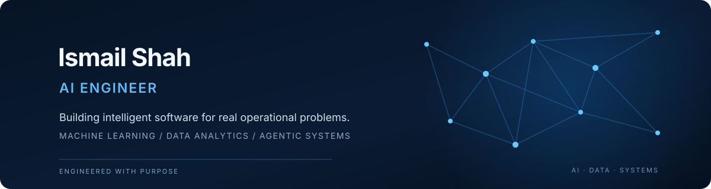

  

<h1 align="center">Ismail Shah</h1>

<strong>AI Engineer · Machine Learning · Data Analytics · Backend Systems</strong>

  <a href="https://www.linkedin.com/in/ismail-shah-57b425327">LinkedIn</a>
  &nbsp;·&nbsp;
  <a href="https://github.com/Ismailshah-123">GitHub</a>

---

## Profile

I build software that turns data and AI capabilities into useful operational tools. My work spans machine-learning applications, computer vision, data analytics, backend engineering, and agentic workflows.

I approach projects from the problem outward: understand the user and business process, identify where data or automation can help, build the application around that need, and make its outputs clear enough to review and act on.

## Selected work

### AI systems and applied engineering

| Project | Problem addressed | What the application does |
|---|---|---|
| [AI Voice Agent Platform](https://github.com/Ismailshah-123/Multi_voice_agent) | Businesses can lose enquiries when calls are missed, responses are delayed, or routine requests require staff time. | Connects voice conversations to business knowledge and backend actions. Vapi handles the voice layer while FastAPI processes webhooks, validates structured tool requests, and supports workflows such as appointment booking. |
| [MultiCancer Ultimate](https://github.com/Ismailshah-123/Multi-Cancer-App) | Medical-image research involves reviewing image patterns across different tissue and organ categories. | Brings together CNN-based image-classification workflows, prediction visualizations, saliency views, and a medical knowledge assistant in one research application. |
| [DPS AI Student Interview System](https://github.com/Ismailshah-123/dps-interviewer) | Recording interviews and preparing consistent documentation can create repetitive administrative work for school staff. | Demonstrates a workflow for consent-aware interview recording, transcription, structured documentation, and staff review. The repository describes a demo using synthetic data; it is not represented as production-ready. |
| [CareerGPT](https://github.com/Ismailshah-123/Career-making) | Applicants must repeatedly interpret job descriptions, compare requirements, and prepare tailored applications. | Explores role discovery, resume-to-job matching, application preparation, and multi-step agent workflows. |
| [Lead Intelligence Engine](https://github.com/Ismailshah-123/lead-scrapper) | Sales research is time-consuming when company information is scattered and lead records contain gaps. | Organizes prospect research and qualification around available evidence, source signals, and explicit flags for missing or conflicting information. |
| [Revenue Recovery AI](https://github.com/Ismailshah-123/Revenue-Recovery) | Follow-up gaps in customer conversations can leave potential revenue opportunities unnoticed. | An MVP for reviewing email conversations, identifying follow-up gaps, and surfacing potential recovery opportunities for human review. |
| [Financial Agent](https://github.com/Ismailshah-123/financial-agent-) | Business and financial information can be difficult to interpret when operational data is spread across workflows. | Explores AI-assisted financial operations, reporting, and decision-support workflows. The project remains under development and validation. |

### Machine learning applications

| Project | Problem addressed | Approach |
|---|---|---|
| [MultiCancer Ultimate](https://github.com/Ismailshah-123/Multi-Cancer-App) | Research workflows need tools to explore image categories and model outputs consistently. | PyTorch-based CNN image classification, saliency visualization, and supporting retrieval features. |
| [SMS Spam Detection](https://github.com/Ismailshah-123/sms-detection-project) | Unwanted messages make it harder for users to identify legitimate communications. | Text cleaning, tokenization, stemming, TF-IDF features, and a Naive Bayes classifier, with single and batch prediction interfaces. |
| [Insurance Charges Prediction](https://github.com/Ismailshah-123/insurance-project) | Insurance datasets contain relationships between customer attributes and observed charges that benefit from structured analysis. | Exploratory analysis, feature engineering, model-based estimates, and an interactive dashboard with model interpretation work. |
| [Movie Recommendation System](https://github.com/Ismailshah-123/movie-recommender) | Large movie catalogues make it difficult to discover relevant titles. | Combines collaborative-filtering predictions and content-similarity scores to rank recommendations, with genre filtering and movie details. |

### Data analytics and business intelligence

| Project | Business question | Analysis and deliverable |
|---|---|---|
| [USA Regional Sales Analysis](https://github.com/Ismailshah-123/sales-analysis) | Which products, channels, and regions drive revenue and margin, and where do seasonal patterns or outliers affect performance? | Analysis of 2014–2018 sales data covering trends, customer segments, outliers, and budget comparisons, alongside a Power BI dashboard. |
| [Power BI Dashboards](https://github.com/Ismailshah-123/power-bi-dashboards) | How can operational data be made easier for decision-makers to monitor? | Interactive dashboards for HR, student performance, credit-card/customer analysis, and sales performance. |
| [Student Performance Analysis](https://github.com/Ismailshah-123/student-performance-prediction-and-analysis) | What patterns in student data can support a clearer understanding of academic performance? | Notebook-based analysis and predictive modelling, complemented by a Power BI dashboard. |

## Technical capabilities

| Discipline | Tools and methods |
|---|---|
| Programming | Python, SQL, JavaScript, TypeScript |
| Machine learning | Scikit-learn, PyTorch, feature engineering, model evaluation, classification, recommendation systems |
| AI engineering | LLM integration, agent workflows, tool calling, retrieval-augmented generation, prompt and output validation |
| Computer vision | Image classification, CNN workflows, saliency visualization |
| Data analytics | Pandas, NumPy, Jupyter, exploratory analysis, statistical summaries, visualization |
| Backend engineering | FastAPI, REST APIs, Pydantic, SQLAlchemy, webhooks |
| Data and infrastructure | PostgreSQL, SQLite, Redis, Qdrant, FAISS, Docker |
| Interfaces and reporting | React, Streamlit, Power BI, dashboard design |

## How I approach engineering

- **Start with the problem.** Define the user, workflow, constraints, and intended outcome before selecting a model or framework.
- **Build beyond the model.** Connect inference to APIs, data, permissions, interfaces, and operational workflows.
- **Validate before acting.** Treat model output as input that must be checked, especially before triggering consequential actions.
- **Make results reviewable.** Preserve useful context, communicate uncertainty, and keep human review where it matters.
- **Be precise about maturity.** Distinguish prototypes, demos, active development, and production-ready systems.

## Current focus

Reliable agentic applications, applied machine learning, retrieval systems, computer vision, and analytics products that help people make better operational decisions.

---

  <a href="mailto:">Open to conversations about AI engineering, machine learning, data products, and automation</a>

